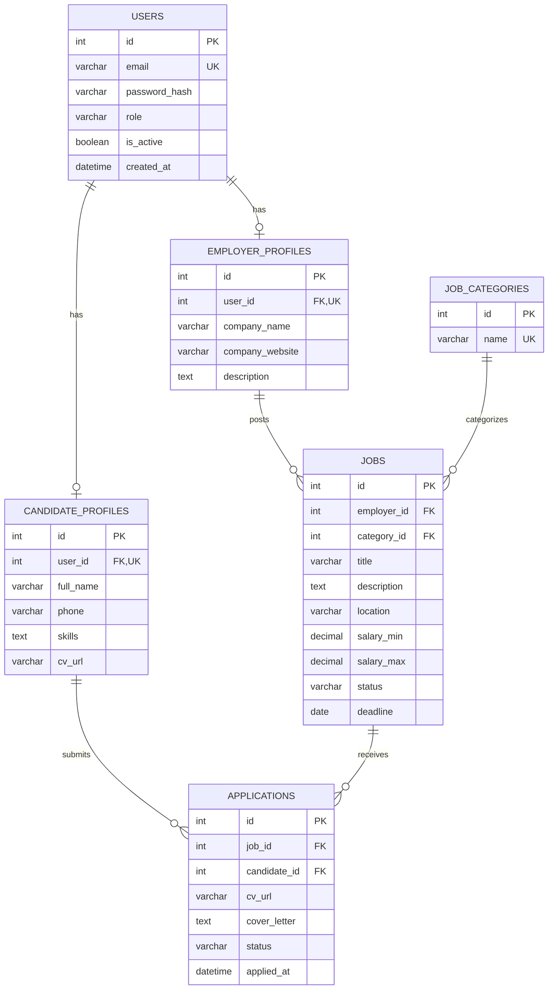

# ERD — Nền tảng kết nối việc làm (MVP)

## Ràng buộc nghiệp vụ
- `users.role` thuộc `candidate`, `employer`, `admin`; mỗi user chỉ có tối đa một hồ sơ tương ứng.
- `applications` UNIQUE(job_id, candidate_id): ứng viên không gửi trùng đơn.
- Tin mới `pending`, admin chuyển sang `published`/`rejected`; employer có thể đóng tin (`closed`).
- Đơn mới `submitted`, có thể chuyển `reviewing`, `accepted`, `rejected`.
- Chỉ tin `published` chưa hết hạn mới được ứng tuyển (phải kiểm tra tại service layer).
- Phân quyền và ownership bắt buộc kiểm tra ở API; frontend không thay thế kiểm tra backend.
- `cv_url` là tham chiếu file, không lưu nhị phân trong DB. Kiểm tra MIME, kích thước và quyền truy cập file.
